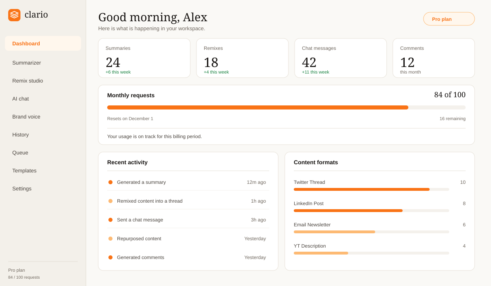

<div align="center">

  

# Clario

**AI content workspace for creators: summarize, remix, chat, and manage brand voice**

[](https://clario-hub.vercel.app)
[](LICENSE)
[](https://typescriptlang.org)
[](https://nextjs.org)
[](https://supabase.com)
[](https://groq.com)
[](https://stripe.com)
[](https://tailwindcss.com)

</div>

---

<div align="center">
  
</div>

---

Clario is a Next.js (App Router) SaaS workspace for creators and teams. It helps you summarize content, repurpose it into platform-native formats, chat with AI, apply brand voice, and track usage from a unified dashboard.

## Features

### Core creation tools
- **Summarizer**: summarize pasted text, URLs, and YouTube videos with multiple summary modes.
- **YouTube summarizer**: paste a YouTube link and generate a summary from transcript/content analysis.
- **Remix Studio**: repurpose one input into multiple platform-native outputs.
- **AI Chat**: creator-focused chat with conversation history.
- **Brand Voice**: save and activate brand voices to keep outputs consistent.

### Creator workflow tools
- **Comment Generator**: generate platform-ready comments with tone/length controls and history.
- **Repurpose**: transform existing content into new formats and angles.
- **Toolkit**: Angle Finder, Bio Builder, Hook Generator, and related AI utilities.
- **Templates**: save reusable prompts/outlines for repeatable work.
- **Queue**: manage comment/content tasks and statuses.
- **Calendar**: plan and track scheduled content/events.
- **AI Memory**: store helpful context (profile/audience/use case) for better outputs.
- **History**: review past summaries, comments, and repurposed outputs.

### Dashboard and analytics
- **Unified dashboard**: summaries, AI chats, remixes, brand voices, comments, and repurposes in one view.
- **Usage visibility**: requests used/left, plan status, usage over time, feature mix, and recent summaries.
- **Analytics data model**: `usage_tracking` events plus SQL analytics views (`dashboard_stats`, `analytics_daily_usage`) for reporting and charts.

### Billing and account
- **Subscription tiers**: Free and Pro plans with monthly request limits (see `/pricing`).
- **Stripe**: Checkout, Billing Portal, and webhook handling with idempotency support.
- **Auth**: Supabase Auth (PKCE) with authenticated app routes.

## Tech stack

| Category | Technology |
| --- | --- |
| Framework | Next.js 16 (App Router) |
| Language | TypeScript 5 |
| UI | React 18, Tailwind CSS, shadcn/ui, Radix UI |
| Charts | Recharts |
| Database | Supabase (PostgreSQL + RLS) |
| Auth | Supabase Auth (PKCE) |
| AI | Groq SDK with compatible-model fallback logic |
| Payments | Stripe (Checkout, Billing Portal, Webhooks) |
| Validation/forms | Zod, React Hook Form |
| Package manager | pnpm |

## Reliability and security

- **RLS-first data access**: core and toolkit tables are designed with row-level security policies (see `supabase/schema.sql`).
- **Input constraints**: schema-level checks (lengths, enums, formats) and application-level validation.
- **AI fallback**: server-side AI calls include fallback/error handling patterns (`src/lib/ai-fallback.ts`).
- **Webhook safety**: processed Stripe webhook events are tracked for idempotency.
- **Usage/rate controls**: profile usage counters, `usage_tracking`, and rate-limit support (`api_rate_limits`, `check_rate_limit`).
- **Secrets**: API keys remain server-side via environment variables.

## SEO and AI discoverability

Public discoverability files and metadata are configured in the app:

- `src/app/robots.ts` (App Router robots; allows public pages, disallows app/auth/api paths)
- `public/robots.txt` (fallback/clarity)
- `src/app/sitemap.ts` (public marketing/legal routes)
- `public/llms.txt` (LLM-oriented product summary and key links)
- `src/app/layout.tsx` (metadata, OpenGraph/Twitter/canonical defaults, JSON-LD)

## Quick start

### Prerequisites

- Node.js 18+
- pnpm (`npm install -g pnpm`)
- Supabase project
- Groq API key
- Stripe account (for billing features)

### Installation

```bash
# 1. Clone the repo
git clone https://github.com/MuhammadTanveerAbbas/Clario-ai.git
cd Clario-ai

# 2. Install dependencies
pnpm install

# 3. Set up environment variables
cp .env.example .env.local
# Fill in values (see Environment variables)

# 4. Apply database schema in Supabase SQL editor
# Use: supabase/schema.sql

# 5. Run the development server
pnpm dev
```

Open `http://localhost:3000`.

## Environment variables

Create `.env.local` (or copy from `.env.example`) and set values for your environment:

```env
# App
NEXT_PUBLIC_APP_URL=http://localhost:3000

# Supabase (Dashboard > Project Settings > API)
NEXT_PUBLIC_SUPABASE_URL=https://your-project.supabase.co
NEXT_PUBLIC_SUPABASE_ANON_KEY=your_supabase_anon_key
SUPABASE_SERVICE_ROLE_KEY=your_supabase_service_role_key

# Groq (https://console.groq.com/keys)
GROQ_API_KEY=your_groq_api_key

# Stripe (https://dashboard.stripe.com/test/apikeys)
NEXT_PUBLIC_STRIPE_PUBLISHABLE_KEY=pk_test_your_key
STRIPE_SECRET_KEY=sk_test_your_key
STRIPE_WEBHOOK_SECRET=whsec_your_secret
NEXT_PUBLIC_STRIPE_PRICE_ID=price_your_pro_monthly_id
STRIPE_PRICE_PRO_MONTHLY=price_your_pro_monthly_id
STRIPE_PRICE_PRO_ANNUAL=price_your_pro_annual_id

# Admin / ops (as used by your deployment)
ADMIN_EMAIL=your-admin-email@example.com
CRON_SECRET=your_cron_secret_if_used

# Optional rate limiting / app config (if used in your environment)
RATE_LIMIT_AUTH_MAX=5
RATE_LIMIT_AUTH_WINDOW=900
RATE_LIMIT_API_MAX=100
RATE_LIMIT_API_WINDOW=60
```

Notes:
- Keep service role keys and Stripe secrets server-side only.
- Use production URLs/keys in production environments.

## Project structure (high level)

```text
clario-ai/
├── public/
│   ├── favicon.svg
│   ├── robots.txt
│   └── llms.txt
├── src/
│   ├── app/
│   │   ├── (app)/                # Authenticated app (dashboard, tools, settings)
│   │   ├── (auth)/               # Auth pages
│   │   ├── (marketing)/          # Landing/pricing/legal pages
│   │   ├── api/                  # API route handlers
│   │   ├── layout.tsx            # Global metadata + providers + JSON-LD
│   │   ├── robots.ts             # Robots metadata route
│   │   └── sitemap.ts            # Sitemap
│   ├── components/
│   │   ├── ui/                   # UI primitives
│   │   ├── layout/               # App shell, sidebar, navbar
│   │   ├── marketing/            # Marketing nav/footer
│   │   └── providers/            # Client providers
│   ├── contexts/                 # Auth/sidebar contexts
│   ├── hooks/                    # Reusable hooks
│   ├── lib/                      # Supabase, AI, Stripe, security, helpers
│   └── types/                    # Type definitions
├── supabase/
│   └── schema.sql                # Master schema (tables, RLS, functions, analytics views)
├── .env.example
├── middleware.ts
├── next.config.ts
└── package.json
```

## Available scripts

| Command | Description |
| --- | --- |
| `pnpm dev` | Start the development server |
| `pnpm build` | Create a production build |
| `pnpm start` | Start the production server |
| `pnpm lint` | Run TypeScript + ESLint checks (project script) |
| `pnpm lint:fix` | Run ESLint with auto-fix |
| `pnpm typecheck` | Run TypeScript type checks |
| `pnpm test` | Run Node test runner (`tests/**/*.test.mjs`) |

## Database setup (Supabase)

Use the master schema file:

- **`supabase/schema.sql`**

It includes (among other things):
- Core tables: `profiles`, `usage_tracking`, `api_rate_limits`, `brand_voices`, `summarizer_history`, `ai_summaries` (compatibility), `remix_history`, chat tables, calendar/image/subscription/feedback tables
- Creator/toolkit tables: `comment_history`, `comment_templates`, `comment_queue`, `repurpose_history`, `toolkit_results`, `ai_memory`, `scheduled_posts`
- **RLS enabled** with per-user policies on user data tables
- **Security constraints/indexes** for common access patterns
- **Functions/triggers**: `handle_new_user`, `update_updated_at`, `increment_usage` (with monthly auto-reset logic), `track_usage`, `reset_monthly_usage`, `check_rate_limit`, brand voice active enforcement
- **Analytics views** (security invoker): `dashboard_stats`, `analytics_daily_usage`

### Important note about schema application
`supabase/schema.sql` is written as a master/fresh-install schema and includes destructive `DROP ...` statements at the top. Review carefully before running on an existing database. For production databases with live data, apply equivalent changes via reviewed migrations instead of running the full destructive script.

## Deployment

### Vercel (recommended)

1. Import the repository into Vercel.
2. Add required environment variables.
3. Set `NEXT_PUBLIC_APP_URL` to your production domain.
4. Deploy.

> AI/API routes may require longer function durations depending on plan/configuration. Verify Vercel function limits for your project.

### Stripe webhook setup

1. Create a webhook endpoint: `https://yourdomain.com/api/stripe/webhook`
2. Subscribe to relevant events (for example: `checkout.session.completed`, `customer.subscription.updated`, `customer.subscription.deleted`)
3. Set `STRIPE_WEBHOOK_SECRET`

### Supabase Auth setup

1. In Supabase Auth URL configuration:
   - Set **Site URL** to your production domain
   - Add `https://yourdomain.com/auth/callback` to **Redirect URLs**
2. Configure OAuth providers (if used), such as Google

## Contributing

1. Fork the repository
2. Create a feature branch (`git checkout -b feature/your-feature`)
3. Commit your changes
4. Open a Pull Request

## License

MIT. See `LICENSE` for details.

## 👨‍💻 Built by Muhammad Tanveer Abbas

<div>

**Muhammad Tanveer Abbas**
Technical Product Partner for B2B SaaS & Internals Tools

[](https://x.com/m_tanveerabbas)
[](https://linkedin.com/in/muhammadtanveerabbas)
[](https://github.com/MuhammadTanveerAbbas)

If this project helped you, please consider giving it a ⭐
